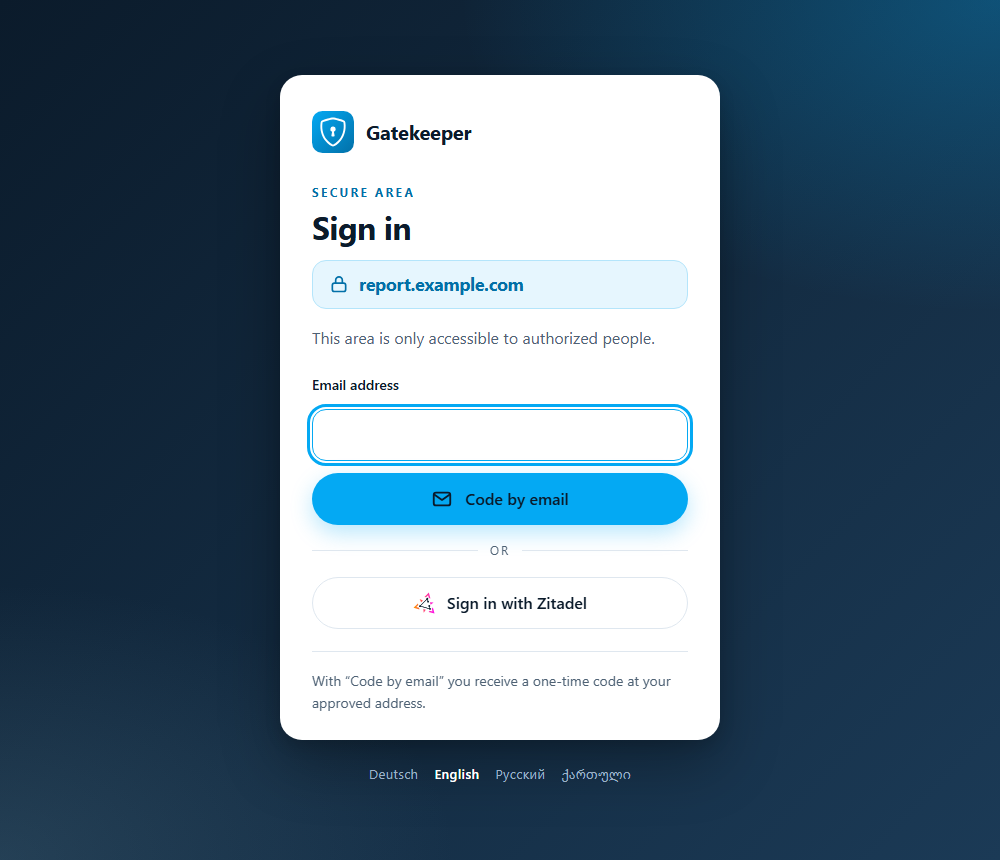
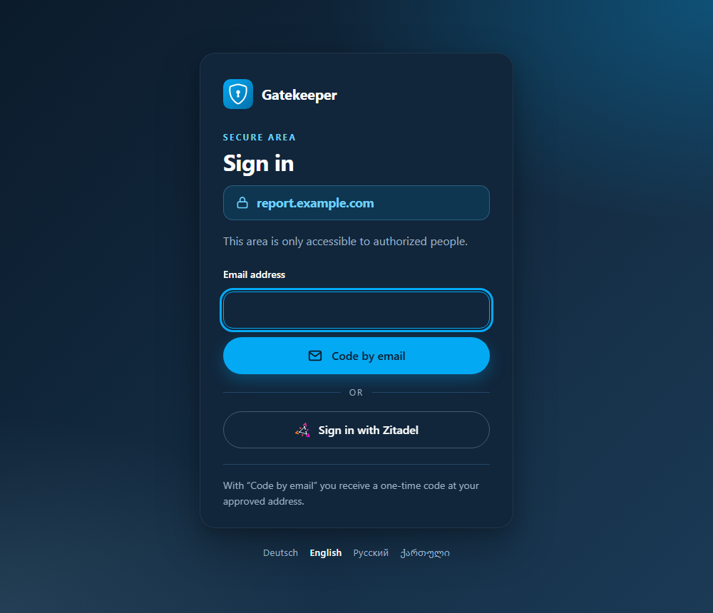
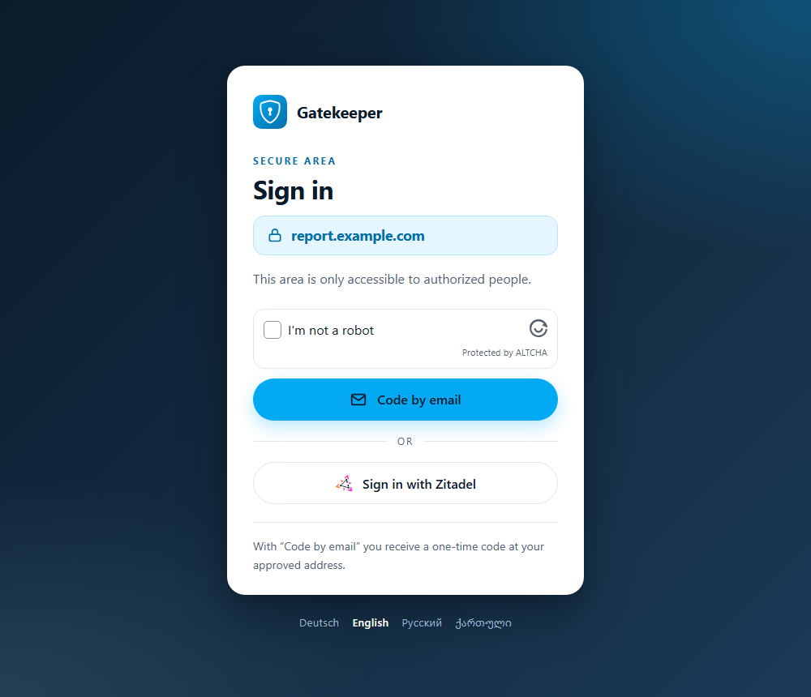
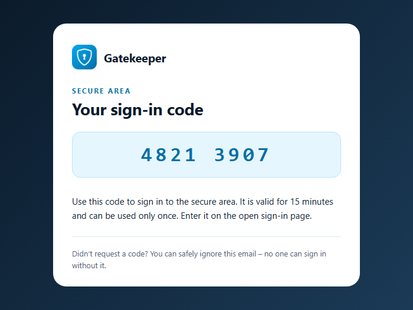

# gatekeeper

This Docker image is managed and kept up to date by [epicsoft LLC](https://epicsoft.one).

A sign-in gate for websites behind a reverse proxy. Visitors sign in with a one-time code sent by email or with an OpenID Connect provider such as Zitadel; who may enter which host is one list of groups in the configuration. Pages and mails come in German, English, Russian and Georgian, in a neutral look or with the name, mark, logo, colours and texts of the configuration.

* Base image: `scratch` — a static Go binary built with `golang:1.27.3-alpine`, platforms `linux/amd64` and `linux/arm64`
* Dockerfile: https://gitlab.com/epicsoft-networks/gatekeeper/-/blob/main/Dockerfile
* Repository: https://gitlab.com/epicsoft-networks/gatekeeper, mirrored to [GitHub](https://github.com/epicsoft-llc/gatekeeper) — issues are welcome on both; code changes only as merge requests on GitLab, the mirror cannot take pull requests
* Container registry: https://gitlab.com/epicsoft-networks/gatekeeper/container_registry
* Docker Hub: https://hub.docker.com/r/epicsoft/gatekeeper
* Changelog: https://gitlab.com/epicsoft-networks/gatekeeper/-/blob/main/CHANGELOG.md
* License: MIT

| | |
|---|---|
| `8080` | all endpoints under `/_gatekeeper/` — reachable only for the reverse proxy, never published |
| `127.0.0.1:8081` | health check inside the container (`gatekeeper healthcheck`) |
| `/etc/gatekeeper/config.json` | the configuration, read-only; secrets in separate files |

## Features

- Two ways in, offered per host: **a one-time code by email** and **any OpenID Connect provider** (Zitadel, Google, Microsoft, GitLab …) — one list of groups decides for all of them
- Works with **nginx `auth_request`** and with **Traefik `forwardAuth`**, so it protects static sites as well as any service behind Traefik
- Pages and mails in German, English, Russian and Georgian; the language follows the browser or the language links
- **Branding** in the configuration: name, footer link, mark, mail logo, colours and any text - without it a neutral look
- Optional **ALTCHA** proof of work before the code by email, checked at the [ALTCHA service](https://gitlab.com/epicsoft-networks/altcha): a bot never sees the address field
- Optional **bounce handling**: no code mail for 48 hours to an address whose code mail bounced
- Access is checked on every request against the current configuration — removing an address or a sign-in method locks out at once
- No database and no volume: sessions are encrypted cookies, pending codes and rate limits live in memory, users and groups come from the configuration
- Optional counting of the sign-in page and its steps in [Umami](https://umami.is), respecting Do Not Track and GPC per host
- One static binary without shell or packages: a 15 MB image, about 5 MiB of memory at rest

## Screenshots

The sign-in page, light and dark - language and colour scheme follow the browser:

 

With `altcha` the code by email starts with the widget, and the code mail:

 

## How it works

```
browser ──▶ reverse proxy ──auth──▶ gatekeeper  /_gatekeeper/auth: 202 · 401 · 403
               │   401 ──────────▶ /_gatekeeper/sign_in   sign-in page at the protected address
               │   403 ──────────▶ /_gatekeeper/denied    "signed in as …, no access"
               │
               └── /_gatekeeper/* ──▶ gatekeeper  forms, code entry, provider start and callback, sign-out
```

1. The proxy asks `/_gatekeeper/auth` on every request. Without a session the visitor sees the sign-in page at the address they asked for.
2. **Code by email:** the visitor enters an address (with `altcha` after a proof of work) and gets the same answer whether it has access or not. Only an address with access receives a mail with an eight-digit code; the code works only in the browser that asked for it, for fifteen minutes and five attempts.
3. **Provider:** the visitor is sent to the provider with state, nonce and PKCE; the callback accepts only a token that go-oidc has verified and an address the provider marks as verified.
4. Either way the address must be in a group the host allows. The session is an encrypted cookie bound to the host.

## Quick start

```yaml
services:
  gatekeeper:
    image: epicsoft/gatekeeper:X.Y.Z
    container_name: gatekeeper
    restart: always
    read_only: true
    cap_drop: [ALL]
    security_opt: ["no-new-privileges:true"]
    volumes:
      - ./config.json:/etc/gatekeeper/config.json:ro
      - ./secrets/gatekeeper_secret:/run/secrets/gatekeeper_secret:ro
      - ./secrets/gatekeeper_smtp_password:/run/secrets/gatekeeper_smtp_password:ro
      - ./secrets/gatekeeper_zitadel_secret:/run/secrets/gatekeeper_zitadel_secret:ro
    networks: [proxy]
    deploy:
      resources:
        limits: {cpus: "0.25", memory: 64M}

networks:
  proxy:
    external: true
```

The image runs as uid `65532`; the secret files must be readable for it. Create the session secret with `openssl rand -base64 48`.

Check a configuration before a restart: `docker run --rm -v ./config.json:/etc/gatekeeper/config.json:ro … gatekeeper check` — it reads the secret files too and lists every problem at once.

## Configuration

A JSON file; an unknown key stops the start. A complete example: [`examples/config.json`](https://gitlab.com/epicsoft-networks/gatekeeper/-/blob/main/examples/config.json).

| Key | Default | Meaning |
|---|---|---|
| `secret_file` | — | file with at least 32 bytes; every cookie key is derived from it. A new secret ends all sessions |
| `trusted_proxies` | — | addresses or networks whose `X-Forwarded-*` headers are believed, see [Trusted proxies](#trusted-proxies). Required; `0.0.0.0/0` and `::/0` are refused |
| `client_ip_header` | `X-Real-Ip` | header with the visitor's address from a trusted proxy |
| `default_language` | `en` | `de`, `en`, `ru` or `ka` — when the browser asks for none of them |
| `session` | `24h` | lifetime of a session, `5m` to `720h` |
| `listen` / `health_listen` | `:8080` / `127.0.0.1:8081` | addresses of the two listeners |
| `groups` | — | group name → list of addresses, lower case, or whole domains as `@example.com` (exactly that domain, not its subdomains; local parts of letters, digits, `.`, `_`, `+`, `-` only). They decide for the code by email and for providers without `groups_claim` |
| `hosts` | — | host name → `login` (methods in the order of the page: `email` or provider ids), `allow` (group names), optional `session`. The entry `*` applies to every host without one; without it an unknown host is refused |
| `providers[]` | — | `id`, `name` (on the button), `icon` (`zitadel` or empty), `issuer` (https), `client_id`, `client_secret_file` (empty for a public client with PKCE), `scopes` (default `openid email profile`), `logout`, `groups_claim` |
| `providers[].groups_claim` | empty | claim with the groups of the account at the provider — a list of names, one name, or an object keyed by name (the role claims of Zitadel). With it, the provider's groups decide against the host's `allow`, not the addresses in `groups`, and `allow` may name groups that only the provider knows |
| `providers[].logout` | empty | `backend` ends the provider session with a server-side call, `browser` sends the visitor to the provider's end-session page, empty ends only the gatekeeper session |
| `mail` | — | required as soon as a host offers `email` |
| `mail.host` / `port` / `tls` | — / `587` / `starttls` | `starttls`, `tls` (implicit) or `none`; with a user name only `starttls` or `tls` |
| `mail.server_name` | `mail.host` | name the server certificate must carry |
| `mail.username` / `password_file` | — | submission account |
| `mail.from` / `from_name` | — | sender of the code mails |
| `mail.code_ttl` / `code_attempts` | `15m` / `5` | lifetime of a code (whole minutes, 1–60) and wrong entries before it is void |
| `mail.link` | `false` | a sign-in button in the code mail, see [Security](#security); the mail then names the host |
| `mail.limits` | see example | `per_client` (code requests and ALTCHA checks per client address; a whole IPv6 /48 gets 16 times the count), `per_address` (per entered address), `total` (mails of the instance; addresses that get in only through a domain entry use at most half of it), `attempts` (code entries per client); each `{count, window}` |
| `mail.bounces` | — | stops mail to an address whose code mail bounced, see [Bounces](#bounces). Needs `mail.username` |
| `mail.bounces.imap_host` / `imap_port` | `mail.host` / `993` | IMAP with TLS from the first byte; the certificate must carry `mail.server_name` on `mail.host`, else `imap_host` |
| `mail.bounces.poll` / `suppress` | `1m` / `48h` | how often the mailbox is read (`10s` to `1h`) and how long a bounced address gets no mail (`1h` to `720h`) |
| `mail.bounces.delete_others` | `false` | also delete every other mail in the mailbox - for an account nobody reads |
| `umami` | — | `url` of `/api/send`, `website` id, `respect_opt_out` (hosts on which Do Not Track and GPC stop the counting) |
| `altcha` | — | `url` of the ALTCHA service (https) and its `site`, see [ALTCHA](#altcha) |
| `branding` | neutral | `name`, `owner`, `url`, `mark_file`, `logo_file`, `colors`, `texts_file`, see [Branding](#branding) |

Client addresses are limited per IPv4 address and per IPv6 /64. The configuration is read once at start; a change needs a restart.

### Trusted proxies

Whatever is in `trusted_proxies` can choose the host and the client address of a request. Keep it narrow: the proxy container, or the Docker network gatekeeper shares with the proxy (`docker network inspect <network>` shows its subnet). Of `X-Forwarded-Host`, `X-Forwarded-Uri` and `client_ip_header` gatekeeper takes what the nearest proxy wrote, the last entry of the last line. A request whose `Host` names one configured host and whose `X-Forwarded-Host` another is refused - a proxy that passes the client's `X-Forwarded-Host` through would otherwise let a session of one host open another.

### Branding

Without `branding` the pages and the mail carry a neutral look: the name "Gatekeeper", a shield on a blue square, no footer line. A mark of `mark_file` also lies large and faint behind the page.

```json
"branding": {
  "name": "Example",
  "owner": "Example Ltd",
  "url": "https://www.example.com",
  "mark_file": "/etc/gatekeeper/brand/mark.svg",
  "logo_file": "/etc/gatekeeper/brand/logo.png",
  "colors": {"brand": "#04a9f3", "brand_strong": "#0270a8", "brand_dark": "#6fd0fb"},
  "texts_file": "/etc/gatekeeper/brand/texts.json"
}
```

| Key | Default | Meaning |
|---|---|---|
| `name` | `Gatekeeper` | next to the mark, in the mail and in the page titles - at most 40 bytes |
| `owner` / `url` | — | the footer line of pages and mail; `url` (http or https) makes it a link and needs `owner` |
| `mark_file` | the shield | an SVG of at most 32 KiB, inlined into every page and used as favicon. Only paths, basic shapes, groups, gradients and clip paths with their presentation attributes pass; anything else - script, `style`, event handlers, links, images, text, external references - stops the start. A pointer is only `url(#id)` to an element of the file. The mark is written out anew, never passed on as it came |
| `logo_file` | the shield as PNG | the image of the code mail: a PNG of at most 64 KiB, 16 to 1024 pixels, shown 42 pixels high |
| `colors` | `#04a9f3`, `#0270a8`, `#6fd0fb` | `brand` (buttons, focus), `brand_strong` (accents on light), `brand_dark` (accents in dark mode), each `#rrggbb`; the text on a button is ink or white, whichever reads better. The default mark keeps its blue |
| `texts_file` | — | JSON like [`texts.json`](https://gitlab.com/epicsoft-networks/gatekeeper/-/blob/main/internal/i18n/texts.json): per language the texts to replace, see [`examples/texts.json`](https://gitlab.com/epicsoft-networks/gatekeeper/-/blob/main/examples/texts.json). Only keys that exist and the placeholders of the original; an unknown key stops the start |

### ALTCHA

With `altcha` the code by email starts with the [ALTCHA](https://altcha.org) widget of the ALTCHA service instead of the address field; the providers stay as they are. gatekeeper checks the solution at the service's `POST /verify` with its `site`, server to server, and the service spends it. Only then a sealed cookie opens the address field, once, for ten minutes, for the same client address and host.

- Create a site in the ALTCHA service whose origins are the protected hosts with code by email, and name it in `site`.
- **Fail closed:** an unreachable service or a refusal means no code by email, with a message; the providers keep working.
- Only this step has a script: its Content Security Policy admits exactly the widget, exactly the challenge and the widget's `blob:` workers; the widget's style gets a nonce. The service is trusted - a compromised one could run its own script here.
- gatekeeper verifies for all visitors from one address, so `RATE_VERIFY_PER_IP` of the service is the ceiling of the step.

### Bounces

With `mail.bounces` every code mail goes out with an envelope sender of its own, `<local>+b-<token>@<domain>` of `mail.from`; the `From` stays `mail.from`.

- **Only real bounces count:** a delivery status notification (RFC 3464) that comes back to such an address with a token gatekeeper knows, names the address that token went to and reports a failure (`5.x.x`, or `4.x.x` with action `failed`). A forged bounce naming someone else's address does nothing.
- gatekeeper reads the inbox of the submission account over IMAP every `poll`, deletes the mails to its `+b-` addresses and leaves other mail alone - unless `delete_others`.
- A bounced address gets no mail for `suppress`; a code request for it gets the same answer as always, the log says `code mail suppressed`. Tokens wait seven days in memory; a restart forgets them.
- **The mail server** must let the account send with the `+` form of its address and deliver plus addresses into its mailbox - a refused envelope sender stops every code mail.

### Provider registration

Register one confidential (or PKCE-only) web application per provider with the redirect URI `https://<host>/_gatekeeper/callback/<id>` for **every** protected host. With `logout: browser` also add `https://<host>/` as post-logout redirect URI. The provider has to deliver `email` and `email_verified`, in the ID token or through userinfo — and, with `groups_claim`, the groups. In Zitadel these are the roles of the project: either the project setting "assert roles on authentication" (`urn:zitadel:iam:org:project:roles`) or an action that writes a flat list such as `gatekeeper:roles`. Name the roles like the groups in `allow`. Roles changed at the provider take effect with the next sign-in.

## nginx

```nginx
server {
    listen 8080;
    server_name report.example.com;
    resolver 127.0.0.11 valid=30s ipv6=off;
    set $gatekeeper gatekeeper:8080;

    location = /_gatekeeper/auth {
        internal;
        proxy_pass http://$gatekeeper;
        proxy_pass_request_body off;
        proxy_set_header Content-Length "";
        proxy_set_header Host $host;
        proxy_set_header X-Forwarded-Host $host;
        proxy_set_header X-Forwarded-Proto https;
        proxy_set_header X-Forwarded-Uri $request_uri;
    }

    location ^~ /_gatekeeper/ {
        proxy_pass http://$gatekeeper;
        proxy_set_header Host $host;
        proxy_set_header X-Forwarded-Host $host;
        proxy_set_header X-Forwarded-Proto https;
        proxy_set_header X-Forwarded-Uri $request_uri;
    }

    location / {
        auth_request /_gatekeeper/auth;
        error_page 401 = /_gatekeeper/sign_in;
        error_page 403 = /_gatekeeper/denied;
        expires -1;
        try_files $uri $uri/ =404;
    }
}
```

`X-Forwarded-Uri $request_uri` is required: after `error_page` nginx no longer knows the query, the gatekeeper takes the way back from this header. `expires -1` makes the browser ask again after signing out. The client address is the `X-Real-Ip` of a Traefik in front, passed on by nginx.

## Traefik

```yaml
services:
  app:
    labels:
      - traefik.http.routers.app.rule=Host(`app.example.com`)
      - traefik.http.routers.app.middlewares=gatekeeper@docker
      - traefik.http.middlewares.gatekeeper.forwardauth.address=http://gatekeeper:8080/_gatekeeper/forward_auth
      - traefik.http.middlewares.gatekeeper.forwardauth.authResponseHeaders=X-Gatekeeper-User
  gatekeeper:
    labels:
      - traefik.enable=true
      - traefik.http.routers.gatekeeper.rule=Host(`app.example.com`) && PathPrefix(`/_gatekeeper/`)
      - traefik.http.routers.gatekeeper.priority=1000
      - traefik.http.services.gatekeeper.loadbalancer.server.port=8080
```

`/_gatekeeper/forward_auth` answers with the whole sign-in page, because Traefik passes the answer of a refusal on to the browser. The router for `/_gatekeeper/` must not carry the middleware. `trusted_proxies` has to contain Traefik's address in the Docker network.

## Endpoints

| Path | Method | Purpose |
|---|---|---|
| `/_gatekeeper/auth` | any | for nginx `auth_request`: `202` with `X-Gatekeeper-User`, `401` without session, `403` without access or for an unknown host |
| `/_gatekeeper/forward_auth` | any | for Traefik `forwardAuth`: `200` with `X-Gatekeeper-User`, otherwise `401`/`403` with the page |
| `/_gatekeeper/sign_in` | GET | sign-in page (status `401`) |
| `/_gatekeeper/denied` | GET | "signed in, no access" (status `403`) |
| `/_gatekeeper/altcha` | POST | checks the ALTCHA solution and opens the address field |
| `/_gatekeeper/email` | POST | requests a code |
| `/_gatekeeper/code` | GET, POST | code entry; `GET` with `t`: the button of `mail.link` |
| `/_gatekeeper/start/<id>` | GET | sends the visitor to provider `<id>` |
| `/_gatekeeper/callback/<id>` | GET | return from the provider |
| `/_gatekeeper/sign_out` | GET | a page with the sign-out button - link here from the protected site |
| `/_gatekeeper/sign_out` | POST | ends the session (and the provider session as configured), then `/` |

## Security

- **Fail closed.** An unknown host, a cookie that does not open, an expired flow or any provider error ends in the sign-in page or a refusal — never in access.
- **Sessions** are AES-256-GCM encrypted cookies (`__Host-gatekeeper`, `Secure`, `HttpOnly`, `SameSite=Lax`), bound to the host they were issued for. Each cookie purpose has its own key, derived from `secret_file` with HKDF.
- **Codes** are eight digits from `crypto/rand`, kept only as HMAC, bound to a cookie of the requesting browser and to the host, valid for `code_ttl`, void after `code_attempts` wrong entries or after use. A new code for the same address and host voids the previous one.
- **The button of `mail.link`** signs in only the browser that asked for the code, by a token of its own, so a wrong one costs no attempt. The code's cookie is `SameSite=Lax` then, so a click in webmail carries it.
- **No hints about addresses.** An address without access gets the same answer, the same cookie and the same code page as one with access; the per-address limit applies to every address. The mail goes out in the background, so the answer takes the same time.
- **Mail** goes only to the normalized address - one of the configuration, or one at a domain entry's exact domain with a plain local part - never to the raw input. Addresses are plain ASCII, checked before lower case. Without STARTTLS (or with a certificate for another name) no password and no mail leave the service.
- **Providers:** state, nonce and PKCE (S256); go-oidc checks signature, issuer, audience and expiry; the address must be marked verified, address and verification come from the same document; userinfo must belong to the same subject.
- **Forms** carry a CSRF token bound to a cookie and the host; cross-origin posts are refused on top (`Sec-Fetch-Site`, `Origin`). Signing out is such a form: a `GET` only shows the button, so a foreign page cannot sign anybody out.
- **Way back** after signing in only to a path on the same host — never `//`, a scheme, a backslash or the gatekeeper's own paths.
- **Pages** have a strict Content Security Policy without scripts (`default-src 'none'`, the one style element by hash), `X-Frame-Options: DENY`, `no-store`, `noindex` - except the ALTCHA step. The mark passes an allowlist, colours are only `#rrggbb`.

Decided on purpose:

- **A code is as safe as the mailbox.** Whoever reads the mail of an address with access can sign in for it.
- **Foreign code requests can lock out an address for a while:** the per-address limit counts every request for it, whoever makes it - otherwise a flood could mail one inbox without end.
- **Sessions live only in the cookie.** Signing out removes the cookies of this browser; a copied session cookie stays valid until `session` ends. Removing the address or the method in the configuration ends it at once.
- **`groups_claim` trusts the provider's group names** - use it only with a provider whose groups the users cannot create or join themselves.
- **`X-Gatekeeper-User` carries the address only**, not the provider.
- **Umami counts only when configured**, and on the hosts in `respect_opt_out` not for Do Not Track and GPC.

## What is stored and logged

| | Content | Kept |
|---|---|---|
| Browser | session cookie (address, method, time of sign-in, the provider's ID token for the logout), cookies for a pending code, a provider sign-in, a solved ALTCHA and the CSRF token | session until `session` ends or sign-out, the others minutes to a day |
| Memory | pending codes and their link tokens as HMAC with address and host, rate limit counters, spent ALTCHA tickets; with `mail.bounces` the token of every code mail with its address and the addresses that bounced | until expiry; tokens seven days, bounced addresses `suppress` |
| Mail | the code, sent to the address with access | not stored by the service |
| Umami (optional) | sign-in page view and steps with host, path, referrer, browser language, client address and user agent | as kept by Umami |
| Log | sign-ins and sign-outs with host, method and address; provider sign-ins without access with the address the provider verified; code requests with host (the address only if it has access); used-up codes, rate limits, mail, provider and ALTCHA errors; bounced and suppressed code mails with the address | as long as the container log is kept |

Client addresses, codes, tokens and cookies never reach the log.

## Commands

| Command | |
|---|---|
| `gatekeeper` / `gatekeeper serve` | runs the service; `-config` or `GATEKEEPER_CONFIG` names the file |
| `gatekeeper check` | checks the configuration and its files, exit code 1 with the list of problems |
| `gatekeeper healthcheck` | `-addr` of the health listener, used by the image's `HEALTHCHECK` |
| `gatekeeper version` | the version the image was built as |

## Versions

| Tag | |
|---|---|
| `X.Y.Z` | a release from the git tag — the only tag a deployment should pin |
| `X.Y`, `X` | the newest release of that line |
| `latest` | branch `main` and the newest release |
| `develop` | branch `develop`, GitLab registry only |

## Development

```bash
go test ./...                      # all tests, in-process, a few seconds
go test -race ./...                # in Linux, as CI does
go test -run '^$' -fuzz FuzzMark ./internal/brand/   # and the other Fuzz targets
docker build -t gatekeeper:dev .
```

## Reporting problems

Issues are welcome on [GitLab](https://gitlab.com/epicsoft-networks/gatekeeper/-/issues) and [GitHub](https://github.com/epicsoft-llc/gatekeeper/issues); a security problem as a **confidential issue** on GitLab, see [`SECURITY.md`](https://gitlab.com/epicsoft-networks/gatekeeper/-/blob/main/SECURITY.md).

## License

[MIT](https://gitlab.com/epicsoft-networks/gatekeeper/-/blob/main/LICENSE) — Copyright (c) 2026 epicsoft LLC / Alexander Schwarz

Third-party software in the image — Go, `github.com/coreos/go-oidc`, `github.com/go-jose/go-jose`, `golang.org/x/oauth2`, the icon `shield-lock` of [Bootstrap Icons](https://icons.getbootstrap.com) in the default mark (MIT) and the CA certificates of Alpine — remains under its own licenses.
